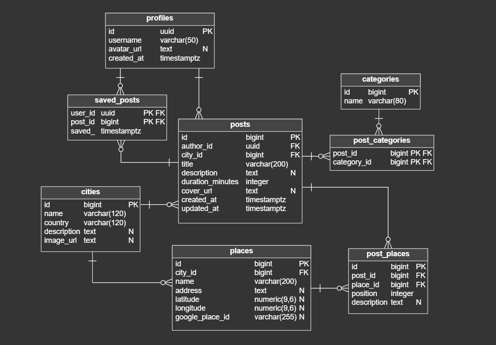

# Geome Explore – Dokumentacja projektu

## 1. Opis projektu

Geome Explore to aplikacja mobilna służąca do odkrywania miast na podstawie doświadczeń i opinii innych użytkowników.

Główną ideą projektu jest możliwość tworzenia tematycznych zbiorów miejsc w formie wpisów przypominających playlisty. Autor może wybrać miasto, dodać miejsca w określonej kolejności oraz opisać swoje doświadczenia związane z każdym z nich. Wpisy mogą zawierać zarówno rekomendacje, jak i negatywne opinie.

Pozostali użytkownicy mogą przeglądać i zapisywać takie zbiory, aby łatwiej planować zwiedzanie. Aplikacja ma stanowić alternatywę dla czasochłonnego wyszukiwania rekomendacji w mediach społecznościowych.

Wyszukiwanie i filtrowanie wpisów według kategorii oraz dostępnego czasu pozwoli użytkownikowi znaleźć propozycje zwiedzania dopasowane do jego zainteresowań i możliwości czasowych.

## 2. Wymagania funkcjonalne

### 2.1. Konta użytkowników

- Rejestracja nowego użytkownika.
- Logowanie i wylogowywanie.
- Przeglądanie własnego profilu.
- Wyświetlanie opublikowanych i zapisanych wpisów.

### 2.2. Tworzenie i zarządzanie wpisami

- Tworzenie nowego wpisu przypisanego do wybranego miasta.
- Nadawanie wpisowi tytułu i kategorii.
- Dodawanie ogólnego opisu wpisu.
- Dodawanie miejsc w określonej kolejności.
- Dodawanie własnych opisów i opinii do poszczególnych miejsc.
- Zmiana kolejności miejsc.
- Określanie szacowanego czasu potrzebnego na odwiedzenie miejsc.
- Edytowanie i usuwanie własnych wpisów.
- Publikowanie wpisów, aby były dostępne dla innych użytkowników.

Wpis nie musi przedstawiać wyłącznie rekomendowanych miejsc. Może zawierać również subiektywne opinie, porównania i negatywne doświadczenia.

### 2.3. Przeglądanie i zapisywanie wpisów

- Przeglądanie wpisów opublikowanych przez innych użytkowników.
- Wyświetlanie szczegółów wpisu wraz z uporządkowaną listą miejsc i opisami.
- Zapisywanie wybranych wpisów we własnej kolekcji.
- Usuwanie wpisów z zapisanej kolekcji.
- Przechodzenie do informacji o miejscach powiązanych z wpisem.

### 2.4. Miasta i miejsca

- Przeglądanie stron miast zawierających podstawowe informacje i powiązane wpisy.
- Wyszukiwanie miejsc podczas tworzenia wpisu.
- Wyświetlanie podstawowych informacji o miejscu, np. nazwy i adresu.
- Powiązanie jednego miejsca z wieloma wpisami różnych użytkowników.

### 2.5. Wyszukiwanie i filtrowanie

- Wyszukiwanie wpisów według miasta.
- Filtrowanie według kategorii.
- Filtrowanie według szacowanego czasu zwiedzania.
- Łączenie kilku kryteriów wyszukiwania.

W pierwszej wersji czas zwiedzania będzie wartością szacunkową przypisaną do wpisu, bez automatycznego wyznaczania optymalnej trasy.

## 3. Funkcjonalności dodatkowe

Poniższe funkcje mogą zostać zrealizowane w zależności od dostępnego czasu:

- Oznaczanie odwiedzonych miast i miejsc.
- Wyświetlanie statystyk odwiedzonych miast i miejsc w profilu.
- Komentowanie wpisów innych użytkowników.
- Integracja z Google Places API w celu wyszukiwania lokalizacji i pobierania ich danych.
- Prezentacja miejsc na mapie.

## 4. Wymagania niefunkcjonalne

- **Platforma:** aplikacja mobilna przeznaczona na system Android, rozwijana z wykorzystaniem Fluttera.
- **Przechowywanie danych:** centralna baza danych umożliwiająca synchronizację wpisów i zapisanych kolekcji między urządzeniami.
- **Bezpieczeństwo:** uwierzytelnianie użytkowników oraz kontrola dostępu do danych na poziomie backendu (Row Level Security).
- **Komunikacja:** asynchroniczna wymiana danych między aplikacją a backendem.
- **Architektura:** oddzielenie interfejsu użytkownika od logiki aplikacji i warstwy dostępu do danych.

## 5. Projekt interfejsu użytkownika

### 5.1. Ekrany podstawowe

#### 5.1.1. Strona miasta (City – ekran główny)

Główny ekran aplikacji, dostępny również bez logowania.

- Nazwa, zdjęcie i krótki opis wybranego miasta.
- Możliwość wyszukania i zmiany miasta.
- Sekcja **Most saved** z wpisami najczęściej zapisywanymi przez użytkowników.
- Sekcja **Recently added** z najnowszymi wpisami.
- Przeglądanie wpisów według kategorii, z przejściem do ekranu Explore.
- Przejście do szczegółów wpisu oraz do pełnej listy wpisów dotyczących miasta.
- Przycisk **Create a post** umożliwiający rozpoczęcie tworzenia wpisu.

Przy pierwszym uruchomieniu użytkownik wybiera miasto. Przy kolejnych uruchomieniach aplikacja wyświetla ostatnio wybrane miasto.

#### 5.1.2. Explore (wyszukiwanie wpisów)

- Przeglądanie wszystkich publicznych wpisów.
- Wyszukiwanie wpisów według miasta.
- Filtrowanie według jednej lub kilku kategorii.
- Filtrowanie według maksymalnego dostępnego czasu zwiedzania.
- Łączenie kryteriów wyszukiwania.
- Sortowanie według liczby zapisów lub daty publikacji.
- Przejście do szczegółów wybranego wpisu.

Ekran jest dostępny bez logowania. Wybranie kategorii na stronie miasta otwiera Explore z odpowiednim filtrem.

#### 5.1.3. Saved (zapisane wpisy)

- Lista wpisów zapisanych przez zalogowanego użytkownika.
- Grupowanie zapisanych wpisów według miast.
- Przejście do szczegółów wpisu.
- Możliwość usunięcia wpisu z zapisanych.

Ekran wymaga zalogowania.

#### 5.1.4. Profil użytkownika (Profile)

- Podstawowe informacje o użytkowniku.
- Przejście do **My posts** – listy własnych opublikowanych wpisów.
- Możliwość edycji i usunięcia własnych wpisów.
- Możliwość wylogowania.

Dla niezalogowanego użytkownika zamiast profilu wyświetlana jest możliwość zalogowania lub rejestracji.

#### 5.1.5. Tworzenie i edycja wpisu

Ekran umożliwiający:

- Wybór miasta, którego dotyczy wpis.
- Wprowadzenie tytułu.
- Wybór jednej lub kilku kategorii.
- Dodanie opcjonalnego opisu całego wpisu.
- Wyszukiwanie i dodawanie miejsc w określonej kolejności.
- Dodawanie własnych opisów i opinii do poszczególnych miejsc.
- Zmianę kolejności dodanych miejsc i usuwanie ich z wpisu.
- Określenie szacowanego czasu potrzebnego na odwiedzenie miejsc.
- Zapisanie i opublikowanie wpisu.

Ten sam formularz będzie wykorzystywany do edycji istniejących wpisów. Tworzenie i edycja są dostępne wyłącznie dla zalogowanych użytkowników.

#### 5.1.6. Szczegóły wpisu

- Okładka, tytuł, kategorie i opis wpisu.
- Informacje o autorze i mieście.
- Liczba miejsc i szacowany czas zwiedzania.
- Lista miejsc w kolejności określonej przez autora.
- Opisy i opinie przypisane do poszczególnych miejsc.
- Możliwość otwarcia wybranego miejsca w Google Maps.
- Możliwość zapisania wpisu lub usunięcia go z zapisanych.
- Przejście do strony miasta.

Przeglądanie wpisu jest dostępne bez logowania. Zapisywanie wymaga zalogowania.

#### 5.1.7. Logowanie i rejestracja

- Formularz logowania do istniejącego konta.
- Formularz tworzenia nowego konta.
- Przechodzenie między logowaniem i rejestracją.

Konto nie jest wymagane do przeglądania publicznej zawartości. Logowanie jest wymagane przy tworzeniu i zapisywaniu wpisów oraz korzystaniu z funkcji profilu.

### 5.2. Ekrany i funkcjonalności dodatkowe

#### 5.2.1. Szczegóły miejsca

- Nazwa, adres i podstawowe informacje o miejscu.
- Lista wpisów, w których pojawia się dane miejsce.
- Możliwość otwarcia lokalizacji w Google Maps.

#### 5.2.2. Odwiedzone miejsca i miasta

- Oznaczanie miejsc i miast jako odwiedzonych.
- Przeglądanie listy odwiedzonych miejsc i miast.
- Wyświetlanie statystyk odwiedzonych miast i miejsc w profilu użytkownika.

#### 5.2.3. Komentarze

- Przeglądanie komentarzy pod wpisami.
- Dodawanie komentarzy przez zalogowanych użytkowników.
- Usuwanie własnych komentarzy.

### 5.3. Nawigacja aplikacji

Dolne menu będzie zawierać cztery zakładki: **City**, **Explore**, **Saved** i **Profile**. Strona miasta będzie ekranem głównym aplikacji. Lista własnych wpisów (**My posts**) będzie dostępna z profilu, a tworzenie nowego wpisu – m.in. przez przycisk na stronie miasta.

Przeglądanie miast i publicznych wpisów nie będzie wymagało logowania. Ekrany logowania i rejestracji będą dostępne przy próbie wykonania czynności wymagającej uwierzytelnienia. Interfejs aplikacji będzie w języku angielskim.

### 5.4. Projekty graficzne

Przygotowano wspólną stylistykę interfejsu opartą na kroju pisma **Montserrat** oraz palecie kolorów: niebieski `#0054D2` (kolor główny), ciemnoniebieski `#1A418E`, jasnoniebieski `#E7EEFA`, tło `#FBFDFF` i kolor tekstu `#323232`. Kolory i style tekstu zostały zdefiniowane centralnie, aby zachować spójność kolejnych ekranów.

## 6. Architektura aplikacji

Aplikacja jest rozwijana we **Flutterze (Dart)**. Interfejs korzysta ze wspólnego motywu oraz podziału kodu na moduły odpowiadające funkcjom aplikacji. Do przechowywania danych wykorzystano **Supabase** z bazą **PostgreSQL**. Aplikacja komunikuje się z usługą przez bibliotekę `supabase_flutter`; konfiguracja połączenia jest wczytywana z pliku `.env`.

Aktualna struktura głównych plików i katalogów kodu aplikacji:

```text
lib/
├── main.dart
├── app/
│   ├── main_screen.dart
│   ├── theme/
│   │   ├── app_colors.dart
│   │   ├── app_text_styles.dart
│   │   └── app_theme.dart
│   └── widgets/
├── features/
│   ├── city/
│   ├── explore/
│   ├── saved/
│   └── profile/
└── shared/
    └── widgets/
```

## 7. Model bazy danych

Model danych został utworzony w bazie **PostgreSQL** udostępnianej przez **Supabase**. Obejmuje osiem tabel aplikacyjnych:


- `profiles` – podstawowe dane profili użytkowników; uwierzytelnianie będzie obsługiwane przez Supabase Auth.
- `cities` – miasta wraz z opisami i zdjęciami.
- `places` – miejsca przypisane do miast.
- `posts` – wpisy tworzone przez użytkowników, z tytułem, opisem i szacowanym czasem zwiedzania.
- `post_places` – miejsca należące do wpisu, ich kolejność oraz opisy autora.
- `categories` – dostępne kategorie wpisów.
- `post_categories` – powiązania wpisów z kategoriami (relacja wiele do wielu).
- `saved_posts` – wpisy zapisane przez użytkowników.

Tabela `post_places` pozwala umieszczać to samo miejsce w różnych wpisach, zachowując osobną kolejność i opis. Popularność wpisu będzie ustalana na podstawie liczby zapisów w `saved_posts`, bez osobnego systemu rekomendacji.

**Supabase Auth** zapewnia obsługę kont i uwierzytelniania użytkowników. Dane logowania są przechowywane w systemie uwierzytelniania Supabase, natomiast tabela `profiles` zawiera dane profilu aplikacyjnego i jest powiązana z kontem użytkownika. Dostęp do danych jest kontrolowany za pomocą uprawnień PostgreSQL i polityk **Row Level Security (RLS)**, które pozwalają rozróżnić operacje dostępne publicznie i wymagające zalogowania.



*Rysunek 1. Wstępny diagram relacji bazy danych Geome Explore.*


## 8. Implementacja

## 9. Testowanie

## 10. Podsumowanie

*Do uzupełnienia po zakończeniu projektu – osiągnięte rezultaty, ograniczenia i możliwości dalszego rozwoju.*
